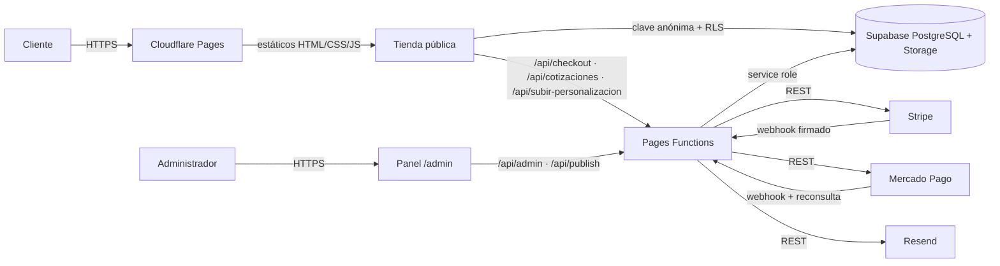
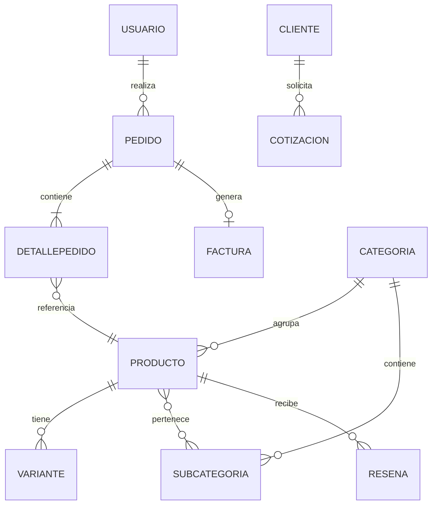
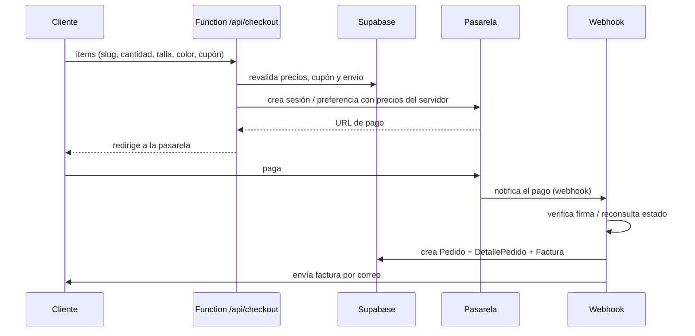

# Diagramas del sistema · Taller Creativo E K

Diagramas formales del proyecto. Están en formato Mermaid (se renderizan en GitHub, GitLab y VS Code).

## 1. Arquitectura general



## 2. Modelo entidad-relación (resumen)



> Nota: el modelo real usa tablas puente para las relaciones muchos-a-muchos (`_CategoriaToProducto`, `_ProductoToSubcategoria`, `_CategoriaToSubcategoria`) y 19 tablas en total. El detalle está en `schema.sql` y `DICCIONARIO_DE_DATOS.md`.

## 3. Flujo de pago con tarjeta (Stripe / Mercado Pago)



## 4. Flujo de cotización

```mermaid
flowchart LR
  C[Cliente] -->|formulario + imagen| FN[/api/cotizaciones]
  FN --> SB[(tabla Cotizacion · estado PENDIENTE)]
  SB --> PA[Panel admin]
  PA -->|cambia estado| SB
  C -->|WhatsApp| WA[Taller]
  PA -->|aceptada| WA
```

## 5. Publicación del catálogo (SSG + Deploy Hook)

```mermaid
flowchart LR
  A[Admin edita en el panel] -->|POST /api/admin| SB[(Supabase)]
  A -->|click Publicar| PB[/api/publish]
  PB -->|Deploy Hook| CF[Cloudflare Pages]
  CF -->|build/sincronizar-supabase.mjs| SB
  SB -->|regenera| J[ek-data.js · ek-config.js · ek-subcategorias.js · ek-blog-data.js]
```
